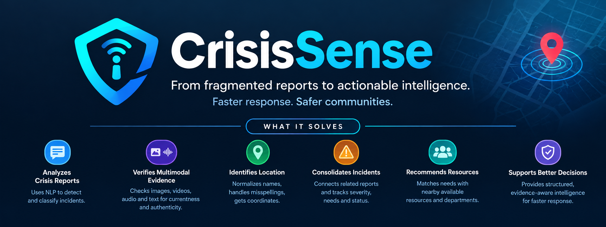
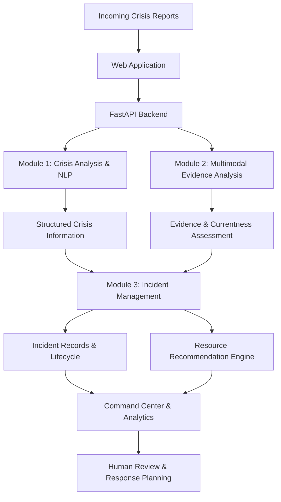

<p align="center">
  
</p>

---


# CrisisSense 🚨
### An Agentic Multimodal Crisis Intelligence & Response Support System

**Turning fragmented crisis reports into structured intelligence for faster, evidence-aware emergency response.**

CrisisSense is a crisis intelligence and response-support prototype designed to analyze incoming crisis reports, extract actionable information from multiple media formats, assess the currentness of supporting evidence, consolidate related reports into incidents, and recommend relevant response resources.

By bringing together Natural Language Processing (NLP), multimodal evidence analysis, incident management, and resource recommendation, CrisisSense aims to help emergency response teams make better-informed decisions during rapidly evolving situations.

> **Project status:** Research and working prototype. Automated analysis and recommendations are decision-support tools, not substitutes for emergency services or authorized human verification.

---

## 📌 Table of Contents

- [The Problem](#-the-problem)
- [Our Solution](#-our-solution)
- [Key Features](#-key-features)
- [System Architecture](#-system-architecture)
- [Core Modules](#-core-modules)
- [Technology Stack](#-technology-stack)
- [Machine Learning & Datasets](#-machine-learning--datasets)
- [Getting Started](#-getting-started)
- [API Documentation](#-api-documentation)
- [Testing](#-testing)
- [Project Structure](#-project-structure)
- [Limitations & Responsible Use](#-limitations--responsible-use)
- [Future Scope](#-future-scope)
- [Contributing](#-contributing)
- [Acknowledgements](#-acknowledgements)

---

## 🌍 The Problem

During emergencies, information often arrives through fragmented text messages, photographs, videos, audio recordings, and other unstructured sources.

This creates several challenges:

- **Information overload:** Responders must process large amounts of unstructured information.
- **Uncertain credibility and currentness:** Previously circulated media may be mistaken for evidence of a current event.
- **Fragmented incident reports:** Multiple reports may describe the same incident without being connected.
- **Unclear response requirements:** Requested medical assistance, rescue, food, water, and shelter may be buried in unstructured messages.
- **Location ambiguity:** Misspellings and inconsistent location names make it harder to identify where help is needed.
- **Resource coordination:** Available resources must be matched to incident needs without assuming that a recommendation is an actual dispatch.

CrisisSense explores how these challenges can be addressed through an integrated, multimodal crisis intelligence workflow.

## 💡 Our Solution

CrisisSense transforms incoming reports into structured, evidence-aware information that can support incident monitoring and response planning.

The system combines four complementary modules:

| Module | Responsibility |
|---|---|
| **01 — Crisis Analysis & NLP** | Detects crisis-related text and extracts incident categories, information types, severity, needs, and locations. |
| **02 — Multimodal Evidence Verification** | Examines text, images, videos, and audio for temporal claims, contextual evidence, and potentially reused media. |
| **03 — Incident & Resource Management** | Stores reports, consolidates related incidents, tracks incident status, and recommends potentially suitable response resources. |
| **04 — Verification & Integration** | Supports the integration of verification-related workflows, schemas, and incident lifecycle requirements. |

The modules work together through a FastAPI backend and a web-based frontend.

## ✨ Key Features

- 🧠 **AI-assisted crisis classification** using machine-learning-based text analysis.
- 🗂️ **Structured incident extraction** for incident type, severity, information category, needs, and location.
- 📍 **Location normalization and geocoding** with fuzzy matching and OpenStreetMap Nominatim.
- 🖼️ **Multimodal evidence analysis** across supported text, image, video, and audio inputs.
- 🕒 **Currentness assessment** using temporal claims and contextual evidence.
- 🔎 **Reused-media detection** using perceptual hashing.
- 🚨 **Incident consolidation** to connect related reports under incident records.
- 🏥 **Resource recommendations** based on incident needs, availability, suitability rules, and geographic distance.
- 📊 **Incident monitoring and analytics** through the frontend interface.
- 🔐 **Authentication and verification-related workflows** integrated into the application.
- 🧪 **Regression testing** for crisis analysis, API behavior, incident management, and application enhancements.

*Feature availability and maturity vary by module. Automated assessments, currentness verdicts, and resource recommendations require appropriate human review.*

## 🏗️ System Architecture



### High-level workflow

1. Receive a crisis report through the application or API.
2. Analyze text and supported media to extract relevant information.
3. Assess evidence currentness and potential conflicts.
4. Save eligible reports and consolidate related reports into incidents.
5. Identify potentially suitable resources and unmet needs.
6. Present the resulting information for review and response planning.

The workflow is intended to support decision-making. It does not automatically establish that a reported emergency is genuine or authorize emergency dispatch.

## 🧩 Core Modules

### 1. Crisis Analysis & Natural Language Processing

The NLP module converts unstructured crisis-related text into structured data.

**Capabilities**

- Crisis versus non-crisis classification.
- Incident-type classification.
- Information-type classification.
- Severity extraction.
- Assistance-needs extraction.
- Location detection, normalization, and geocoding.

**Incident categories**

Building Collapse, Cyclone, Earthquake, Explosion, Fire, Flood, Landslide, Other, Road Accident, and Wildfire.

**Information categories**

Affected Individuals, Caution and Advice, Donations and Volunteering, Infrastructure and Utilities, Other Useful Information, and Sympathy and Support.

**Techniques:** TF-IDF, Logistic Regression, LinearSVC, text preprocessing, fuzzy similarity matching, and geocoding.

### 2. Multimodal Evidence & Currentness Verification

This module examines available evidence to assess whether a crisis-related claim appears current, old, or uncertain.

**Processing components**

- Temporal claim extraction.
- Contextual alignment with reference information.
- Image metadata and OCR analysis.
- Video frame sampling and OCR.
- Speech-to-text extraction from audio.
- Perceptual hashing for potentially reused images.
- Deterministic evidence fusion and conflict detection.

**Currentness outcomes**

| Verdict | Meaning |
|---|---|
| `CURRENT` | Available evidence supports the currentness assessment. |
| `OLD` | Available evidence supports an older or recycled context. |
| `UNCERTAIN` | The available evidence is insufficient or conflicting. |

The module also produces a heuristic confidence value, an action recommendation, and evidence provenance.

These outputs are preliminary assessments, not calibrated probabilities or definitive proof. Human verification remains important, particularly when evidence conflicts or confidence is insufficient.

### 3. Incident & Resource Management

This module maintains incident records and supports response planning.

**Capabilities**

- Store reports and preserve analysis outputs.
- Consolidate related reports into incidents.
- Combine reported needs and retain the highest reported severity.
- Track incident lifecycle status.
- Browse and filter available resources.
- Recommend potentially suitable resources and response departments.
- Identify unmet needs when suitable resources are unavailable.

The prototype uses geographic distance and predefined suitability rules to generate recommendations.

**Important:** Recommendations do not allocate, reserve, or dispatch resources. Resource availability and coordinates may be simulated or illustrative.

### 4. Verification & Application Integration

The integration layer connects analysis results with incident lifecycle and verification-related workflows.

It includes verification-related schemas, service logic, API integration, and frontend components intended to support the broader application workflow.

Verification status and incident status are distinct concepts. Authorized human review is required before a report or incident should be treated as operationally verified.

---

## 🛠️ Technology Stack

| Technology | Purpose |
|---|---|
| Python | Backend and analysis logic |
| FastAPI | REST API |
| Scikit-learn | Machine-learning models |
| TF-IDF, Logistic Regression, LinearSVC | Text classification |
| Pandas, NumPy, SciPy | Data processing and numerical operations |
| Joblib | Model persistence |
| OpenCV | Video processing |
| Pillow | Image processing and metadata extraction |
| Tesseract / pytesseract | Optical character recognition |
| faster-whisper | Speech-to-text processing |
| imagehash | Perceptual image hashing |
| OpenStreetMap Nominatim | Location geocoding |
| React, TypeScript | Frontend application |
| CSS | User interface and theming |
| SQLite / configured database | Prototype data persistence |
| Pytest | Backend testing |
| Node.js and npm | Frontend development and testing |

The exact dependencies and external tools required for a particular module are defined by the project configuration.

## 📊 Machine Learning & Datasets

### Crisis detection

The crisis classifier uses TF-IDF features with Logistic Regression and is trained using CrisisLexT26 data.

| Metric | Reported result |
|---|---:|
| Test accuracy | 92.76% |

### Information-type classification

The information-type classifier combines word-level and character-level TF-IDF features with a LinearSVC model.

| Metric | Reported result |
|---|---:|
| Test accuracy | 71.42% |

These figures are previously reported prototype test results, not a guarantee of current performance or generalization to real-world emergencies. They should be interpreted alongside class-wise precision, recall, F1-score, and an appropriate evaluation methodology.

### Incident-type classification

A labelled incident-type dataset supports classification into ten incident categories. The model uses text features and a LinearSVC-based classification approach.

### Dataset usage

- **CrisisLexT26:** Crisis-related social media data used for crisis classification and information-type analysis, as well as contextual reference work.
- **CrisisMMD:** Used for multimodal crisis-understanding research and text-image evaluation. It is not treated as a source of ground-truth temporal currentness labels.
- **Synthetic resource data:** Used to demonstrate resource browsing and recommendation workflows in the prototype.

Dataset preparation includes text cleaning, duplicate handling, label processing, and feature extraction where applicable.

For responsible evaluation, model results should be reported with dataset provenance, train/test separation, class distributions, and suitable performance metrics.

## 🚀 Getting Started

The following instructions are for local development on Windows using PowerShell. Run backend and frontend commands in separate terminals.

### Prerequisites

Install the following tools as needed:

- [Git](https://git-scm.com/)
- [Python](https://www.python.org/)
- [Node.js and npm](https://nodejs.org/)
- [Tesseract OCR](https://github.com/tesseract-ocr/tesseract) for OCR functionality
- Additional model or media-processing dependencies required by the backend

### 1. Clone the repository

```powershell
git clone https://github.com/Harshitha-G-846/CrisisSense.git
cd CrisisSense
```

### 2. Set up the backend

```powershell
cd backend

py -m venv .venv

.\.venv\Scripts\python.exe -m pip install --upgrade pip
.\.venv\Scripts\python.exe -m pip install -r requirements.txt
```

Initialize the database and import the prototype resource data:

```powershell
.\.venv\Scripts\python.exe -m member3.init_db
.\.venv\Scripts\python.exe -m member3.import_resources
```

Place the required resource files, including `synthetic_resources.csv` and `anchors.csv`, in `backend/data/` if they are not already present.

**Database safety:** Initialization is intended to create missing tables; it is not a database migration tool. Back up existing data before making schema changes.

### 3. Configure environment variables

Check the backend configuration and any available environment example file before starting the application.

Create a local `.env` file only if required by the project configuration. Supply your own valid configuration values and credentials.

**Never commit `.env` files, API keys, passwords, database files containing private data, or other secrets to GitHub.**

### 4. Start the backend

From the `backend` directory:

```powershell
.\.venv\Scripts\python.exe -m uvicorn main:app --reload --port 8000
```

The API should be available at:

- API base URL: `http://127.0.0.1:8000`
- Interactive Swagger documentation: `http://127.0.0.1:8000/docs`

Keep this terminal running.

### 5. Start the frontend

Open a second PowerShell terminal and navigate to the project’s frontend directory:

```powershell
cd frontend
npm install
npm run dev
```

Open the local URL printed by the frontend development server.

If the frontend cannot connect to the backend, check the API base URL and environment configuration in the frontend service files.

> **First-run note:** Some model workflows may require model downloads, additional system dependencies, or configuration. Follow the relevant module requirements if a particular media-processing feature is unavailable.

---

## 🔌 API Documentation

The FastAPI backend exposes endpoints for text analysis, report processing, incident management, resource browsing, and resource recommendations.

The following endpoints are part of the documented prototype interface:

| Method | Endpoint | Purpose |
|---|---|---|
| `POST` | `/analyze-text` | Analyze and save a text report, with incident consolidation where applicable. |
| `POST` | `/analyze` | Analyze supported report inputs and media; save and consolidate when text is supplied. |
| `GET` | `/incidents` | List incidents and report counts. |
| `GET` | `/incidents/{incident_id}` | Retrieve incident details and linked report evidence. |
| `GET` | `/resources` | Browse resources using pagination and filters. |
| `GET` | `/incidents/{incident_id}/resources` | Retrieve resource and department recommendations. |
| `PATCH` | `/incidents/{incident_id}/status` | Update incident lifecycle status. |

### Example: Analyze a text report

**Request**

```http
POST /analyze-text
Content-Type: application/json
```

```json
{
  "text": "A fire occurred near Whitefield and people need medical assistance."
}
```

The response contains structured analysis generated by the backend. Exact response fields depend on the API schema and the analysis results.

### Interactive API documentation

Start the backend and visit:

[`http://127.0.0.1:8000/docs`](http://127.0.0.1:8000/docs)

Swagger UI provides the available routes, request schemas, response schemas, and an interface for trying supported endpoints.

---

## 🧪 Testing

CrisisSense includes backend regression tests and frontend tests for selected features and workflows.

### Backend

From the project root, with the backend dependencies installed:

```powershell
python -m pytest backend/tests -q
```

Alternatively, use the Python interpreter from the backend virtual environment.

### Frontend tests

```powershell
cd frontend
npm test
```

### Production build

```powershell
npm run build
```

Test coverage and results may change as the project evolves. A passing test suite validates the scenarios covered by those tests; it does not establish real-world emergency-response accuracy or readiness for operational deployment.

---

## 📁 Project Structure

```text
CrisisSense/
├── backend/
│   ├── main.py
│   ├── auth.py
│   ├── email_service.py
│   ├── requirements.txt
│   ├── data/
│   ├── models/
│   ├── member1/              # Crisis analysis and NLP
│   ├── member2/              # Multimodal evidence analysis
│   ├── member3/              # Incident and resource management
│   ├── member4/              # Verification and integration
│   └── tests/                # Backend regression tests
│
├── frontend/
│   ├── src/
│   │   ├── components/
│   │   ├── context/
│   │   ├── services/
│   │   ├── App.tsx
│   │   └── main.tsx
│   └── package.json
│
└── README.md
```

*This is a high-level overview. Individual filenames and subdirectories may differ as the project evolves.*

---

## ⚠️ Limitations & Responsible Use

CrisisSense is a prototype intended for research, demonstration, and further development.

- **Currentness verification is heuristic:** Verdicts and confidence values are not independently validated guarantees of truth.
- **Resource information may be simulated:** Resource availability and coordinates should not be assumed to reflect real emergency infrastructure.
- **Recommendations are not dispatches:** Human approval and operational coordination remain necessary.
- **Location matching can be ambiguous:** A matching location name does not necessarily identify the exact incident site.
- **Model performance is dataset-dependent:** Reported test accuracy may not generalize to new events, regions, languages, or communication styles.
- **Incident consolidation uses provisional rules:** Distance, time, and text-similarity thresholds require further validation.
- **Authentication and authorization require careful review:** Sensitive operational deployments need appropriate access controls, auditing, and verification procedures.
- **Privacy and data handling matter:** Crisis reports may contain personal information or sensitive evidence. Appropriate retention, consent, access, and deletion policies are essential.

CrisisSense should not be used as the sole basis for emergency dispatch, evacuation, medical decisions, or other high-impact actions.

If you are experiencing an actual emergency, contact the appropriate local emergency services.

## 🔮 Future Scope

Potential directions for further development include:

- Improved multilingual crisis detection and location extraction.
- Evaluation of currentness verification against appropriately labelled datasets.
- Better detection of conflicting evidence and recycled media.
- Human-in-the-loop verification and auditable incident review.
- More robust incident deduplication and ambiguity handling.
- Resource recommendations informed by verified capacity and road-network travel times.
- Stronger authentication, authorization, and audit trails.
- Improved privacy controls and secure media handling.
- Expanded automated tests, reproducible evaluation, and deployment monitoring.
- Integration with trusted, authorized emergency-management data sources.

These are potential improvements, not claims that every capability is already implemented.

## 🤝 Contributing

Contributions, suggestions, bug reports, and improvements are welcome.

1. Fork the repository.
2. Create a feature branch.
3. Make focused changes and add tests where appropriate.
4. Run the relevant backend tests and frontend checks.
5. Open a pull request describing the change and its impact.

Please avoid committing credentials, private datasets, sensitive incident information, or generated database files.

## 🙌 Acknowledgements

CrisisSense builds on open-source software and research resources, including:

- [CrisisLex](https://crisislex.org/) — crisis-related social media datasets and research.
- [CrisisMMD](https://crisisnlp.qcri.org/crisismmd) — multimodal crisis dataset research.
- [OpenStreetMap](https://www.openstreetmap.org/) and [Nominatim](https://nominatim.org/) — geographic data and geocoding.
- [Scikit-learn](https://scikit-learn.org/) — machine-learning tools.
- [FastAPI](https://fastapi.tiangolo.com/) — API framework.
- [React](https://react.dev/) — frontend library.

Please consult the original dataset and software licenses and attribution requirements before redistributing data or deploying the system.

---

**Built as a prototype exploring how AI-assisted crisis intelligence can support more informed emergency response.**

[Repository](https://github.com/Harshitha-G-846/CrisisSense) · [Report an issue](https://github.com/Harshitha-G-846/CrisisSense/issues) · [Explore the API](#-api-documentation)
